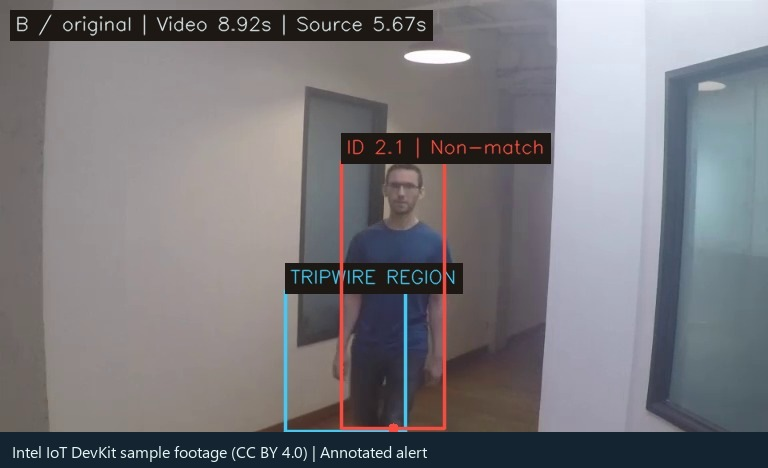

# Face-Aware Tripwire Surveillance

A three-member computer vision lab using one recorded camera and one rectangular tripwire region. YOLO11n and ByteTrack track people, YuNet and SFace check enrolled faces near entry, and Colab displays one JPEG for each clear non-match.

## Quick start

1. Open the notebook in Colab. Keep **CPU**, **Enroll demo** enabled and **Upload photo** disabled.
2. Choose **Runtime → Run all**. The notebook downloads the footage and weights. The default requires no recording, photo, or API key.
3. Play the annotated MP4 and scroll to the event table. To save the alert JPEG, set **Alert number** to **1** and run that cell.

Submit [the notebook](face_aware_tripwire.ipynb) and [the PDF report](face_aware_tripwire_report.pdf) to Classroom.

## Demo sequence

| In playback order | Source time | Expected decision |
|---|---:|---|
| Person A approaches | 74.50–81.00 s | Green **Match: Person A** |
| A different actor approaches, pauses, then leaves | 3.25–19.83 s | Red **Non-match**, one JPEG during the dwell, then **Exit / Rearmed** |
| Person A replays with the head region covered | 74.50–80.00 s | Amber **Unverified**, no JPEG |

The enrollment frame is at **83.00 s**, outside the evaluation intervals. The fixed rectangle is **(285, 290)–(405, 431)** in the **768 × 432** source. The notebook joins the clips in the order above, covers the top 41% of each tracked person box in the derived replay before YuNet inference, and writes a silent MP4 with overlays. Person A is a pseudonym. Same-recording results demonstrate the pipeline on this clip.

The recorded verification run processed **343 frames at 9.2 fps** in a fresh local CPU kernel. The green entry had a median cosine of **0.571**, the red entry **0.011**, and the derived amber entry yielded **zero usable faces**. The red track stayed inside for **159 observed frames** and produced one JPEG before its confirmed exit.

| Presenter | Workflow |
|---|---|
| Member 1 | Show the region preview, bottom-center dot and exit rearm. |
| Member 2 | Show the enrollment crop and explain the green, red and amber decisions. |
| Member 3 | Play the video, point to the red event row and download JPEG 1. |

## Alert preview

Derived from Intel IoT DevKit's `face-demographics-walking-and-pause.mp4` under CC BY 4.0. The preview adds the region, person box, decision and timestamps. [Source and footage preview](https://github.com/intel-iot-devkit/sample-videos/blob/master/face-demographics-walking-and-pause.mp4) · [Direct MP4](https://raw.githubusercontent.com/intel-iot-devkit/sample-videos/master/face-demographics-walking-and-pause.mp4) · [License](https://creativecommons.org/licenses/by/4.0/)
